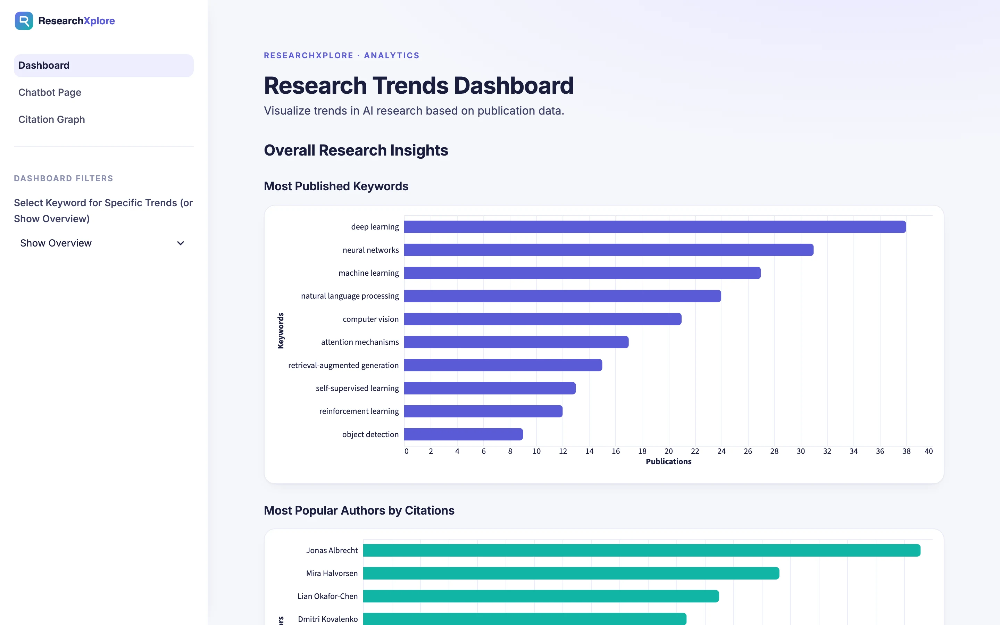
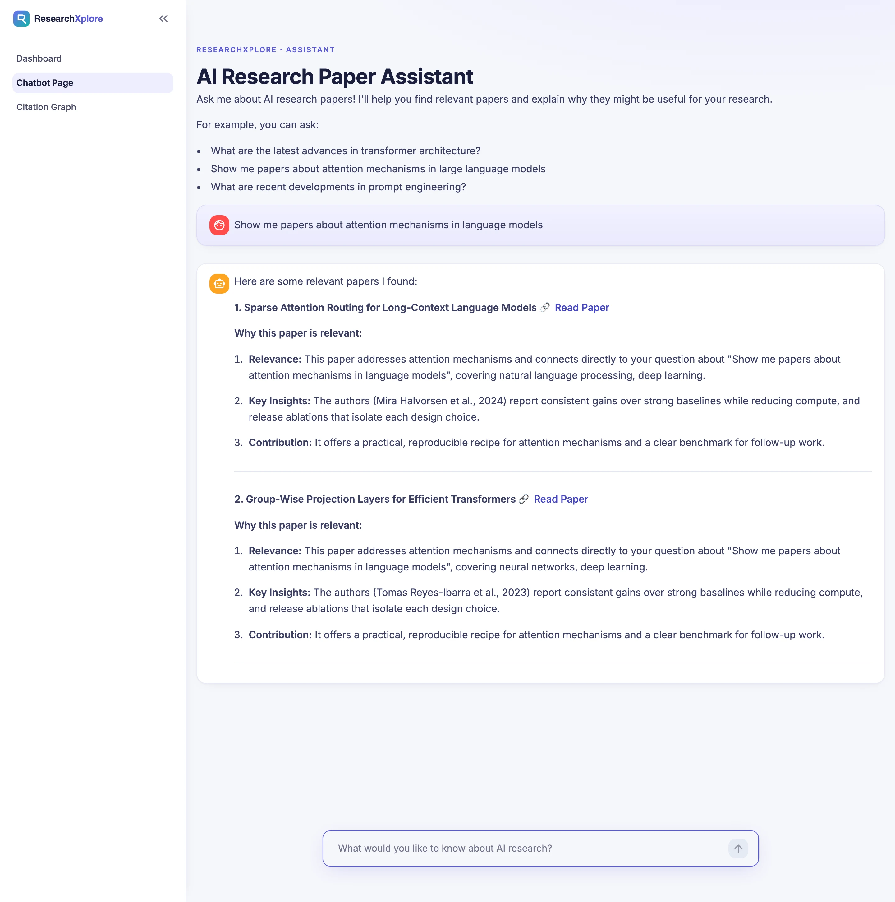
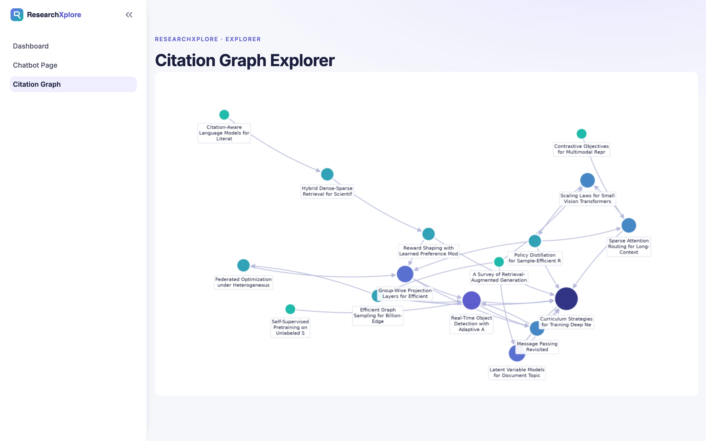
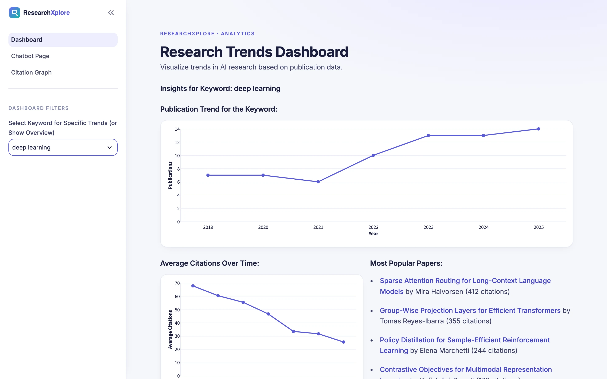
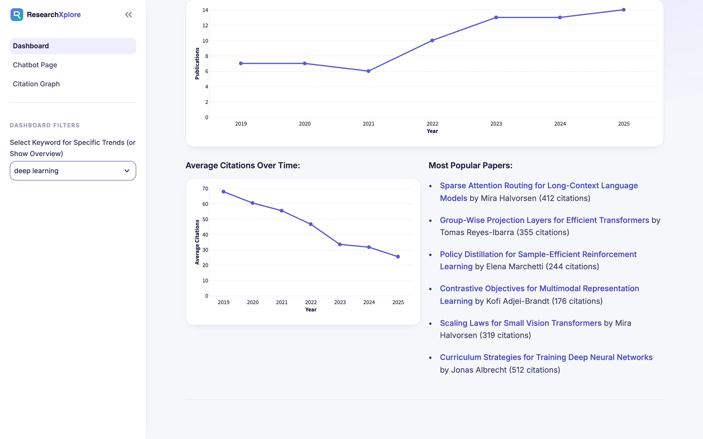
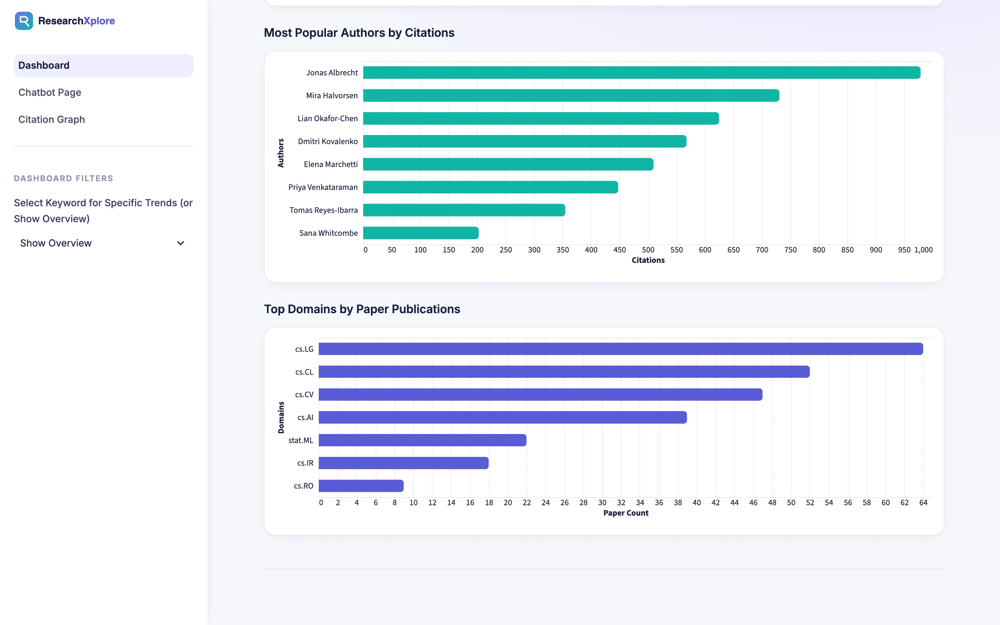

# Research-Assistant-X

**An AI research paper recommender: trends dashboard, retrieval-augmented paper assistant and citation graph explorer.**

Python · Streamlit · Prefect · PostgreSQL · Milvus · Dgraph · Gemini

<table>
  <tr>
    <td></td>
    <td></td>
  </tr>
  <tr>
    <td colspan="2"></td>
  </tr>
</table>
Screenshots are real captures of a local build running on fictional demo data.

---

## Product at a Glance

| | |
|---|---|
| **What it is** | Pipeline and Streamlit app that ingests arXiv and Semantic Scholar papers and helps people discover relevant research |
| **Surfaces** | Trends dashboard, paper-recommendation chatbot, citation graph explorer |
| **Retrieval** | `gte-large` embeddings (1024-dim) in Milvus, Gemini-written relevance summaries |
| **Analytics** | SQL RPC functions on PostgreSQL (Supabase) |
| **Graph** | Citation relationships in Dgraph, rendered with networkx and matplotlib |
| **Orchestration** | Prefect flow that ingests and stores papers every 4 hours |
| **Packaging** | Docker, configured for a Hugging Face Space |

## Product Showcase

<table>
  <tr>
    <td> Per-keyword publication trend and average citations over time.</td>
    <td> Most popular papers for the selected keyword.</td>
  </tr>
  <tr>
    <td> Most cited authors and top domains.</td>
  </tr>
</table>

## Key Features

- Ingestion from arXiv and Semantic Scholar, with PDF parsing and section extraction.
- LLM keyword and domain extraction at ingest time.
- Chunking and embedding with `gte-large`, vector search in Milvus.
- Chatbot that returns papers with a Gemini-written explanation of why each is relevant.
- Dashboard of publication trends, average citations, top keywords, authors and domains.
- Citation graph explorer backed by Dgraph.

## Architecture

Ingestion (Python + Prefect) feeds three stores: PostgreSQL for metadata and analytics, Milvus for vectors and Dgraph for citations. The Streamlit app reads from them: SQL for the dashboard, vector search plus Gemini for the chatbot, graph data for the explorer. See [docs/ARCHITECTURE.md](docs/ARCHITECTURE.md).

## Engineering Highlights

- Polyglot persistence: relational, vector and graph stores chosen by data shape.
- Scheduled Prefect flow for ingestion and storage.
- LLM extraction done once at ingest, so dashboard analytics are plain SQL.
- Relevance filtering before Gemini generates summaries.
- Analytics computed by SQL RPC functions inside PostgreSQL.

## Status & Scope

- The original app needs Supabase, Zilliz, Dgraph and Gemini/Groq credentials, which are not included. Its embedding, vector search, Gemini RAG and LLM processing are implemented, not mocked.
- The screenshots come from a demo mode: the original Streamlit UI scripts run unchanged against in-memory stand-ins with fictional papers and authors. Retrieval there is keyword matching and chatbot replies are canned, not live model output.
- The UI styling in the screenshots (theme, logo, chart palette) is a presentation layer added for this demo.
- The FastAPI `/recommend` endpoint is a stub, and the citation graph is a static image rather than an interactive view.
- Production source code is not included.

## Documentation

- [Product overview](docs/PRODUCT_OVERVIEW.md)
- [Architecture](docs/ARCHITECTURE.md)
- [Technical case study](docs/TECHNICAL_CASE_STUDY.md)
- [Engineering challenges](docs/ENGINEERING_CHALLENGES.md)
- [Privacy and source](docs/PRIVACY_AND_SOURCE.md)

## Rights

See [RIGHTS.md](RIGHTS.md).
