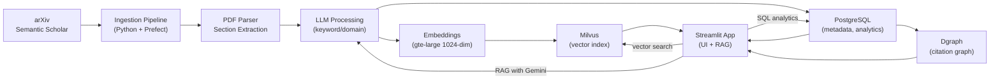

# Architecture

All diagrams are original and conceptual. They describe responsibilities and data flows, not exact class or file names.

## System overview

## 1. Data pipeline

Papers flow through four stages:

- **Fetch:** Parallel download from arXiv and Semantic Scholar APIs.
- **Parse:** PDF extraction with section boundaries (abstract, introduction, methods, results, conclusion).
- **Enrich:** LLM-driven extraction of keywords, research domain, and key concepts per section.
- **Embed:** Sentence-transformer encoding (1024 dimensions) into Milvus for semantic search.

Prefect schedules the ingest and storage flow every 4 hours.

## 2. Storage layers (polyglot persistence)

- **PostgreSQL:** Relational data—paper metadata, authors, publication dates, abstracts. SQL RPC functions compute trends (top keywords, citation count averages, publication velocity over time).
- **Milvus:** Vector index for the 1024-dimensional embeddings. Used for semantic similarity search.
- **Dgraph:** Citation graph in a graph database. Nodes are papers; edges represent citation relationships. Read by the citation graph explorer.

## 3. Streamlit app (three pages)

**Page 1: Dashboard & Trends**

- Sidebar keyword selector (e.g., "deep learning").
- Overview: most published keywords, most cited authors, top domains.
- Per keyword: publication trend, average citations over time, most popular papers.

**Page 2: Chatbot Recommender (RAG)**

- User text input: "Show me papers about X".
- Pipeline: vectorize the query → retrieve top-k candidates from Milvus → filter for relevance → generate per-paper summaries with Gemini → display titles with links and relevance explanations.
- Fallback in demo mode: canned summaries.

**Page 3: Citation Graph**

- NetworkX + Matplotlib visualization of the citation network.
- Rendered as a static image; node styling in the demo is a presentation choice.
- Demo mode: generates a plausible graph with fictional papers.

## 4. FastAPI stub

A `/recommend` endpoint is sketched but not implemented; the Streamlit chatbot handles recommendations in the current architecture.

## 5. Key engineering decisions

- **Polyglot storage:** Relational (metadata), vector (similarity), and graph (citation) databases are best-fit tools for their domains rather than forcing all data into one system.
- **Scheduled pipeline:** Prefect orchestrates ingestion and storage on a schedule, separate from the app.
- **LLM enrichment:** Keywords and domains are extracted server-side before ingestion, not computed per query, to amortize LLM cost.
- **Read-side UI:** The Streamlit app reads from the backend stores; ingestion runs separately.
